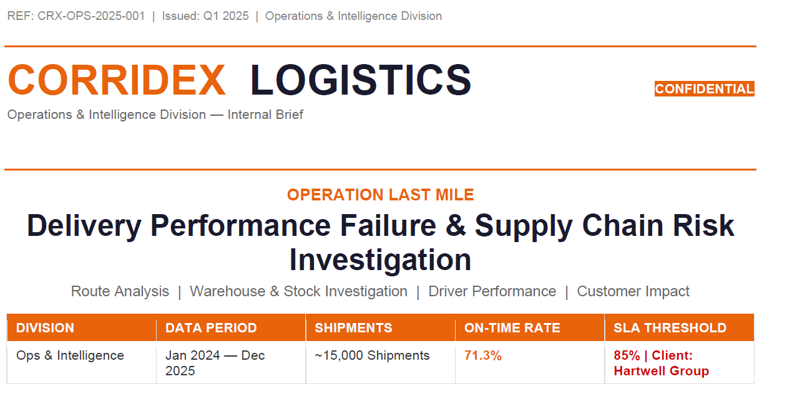
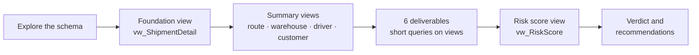

# Operation Last Mile: Diagnosing a €4.2M Delivery Crisis with SQL

> Four executives had four theories about why deliveries were failing.
> I tested every one of them against 15,000 shipments in SQL Server.
> The biggest answer came from a single yes/no column.



> **Tools:** SQL Server (T-SQL) · Views · Window functions · CASE logic


> [!NOTE]
> **Simulated Case Study.** This project is based on *Operation Last Mile*, a Case Study from DWD Academy. CorridexLogistics, its clients, staff and the brief are simulated to mimick real world problem in the Logistics and Transportation Industry, and the dataset is synthetic. Any resemblance to real organisations or people is coincidental. The SQL, analysis and recommendations are my own work.
> The Dataset might be synthetic but the problem, analytical and technical reasoning and decision is real and true!!!

---

## Overall Summary

| | |
| --- | --- |
| **On-time rate** | 70.1% against an 85% SLA (−14.9 pp), and falling: 74.8% in 2024 → 65.3% in 2025 |
| **Contract at risk** | €4.2M per year (Hartwell Group, largest client) |
| **Strongest driver** | Stock not ready at dispatch drops on-time delivery from **74.5% to 47.4%** |
| **Problem sites** | Amsterdam and Warsaw warehouses: ~25% stock-issue rate vs 6.3% in Berlin |
| **Problem assignment** | Vans on cross-border routes: **41%** on time |
| **Verdict** | An operational problem in two warehouses and one assignment rule, not a pricing problem |

---

## 1. The Business Problem

Corridex Logistics is a pan-European freight company with 5 warehouses, 15 routes, 20 drivers and 12 clients. Every contract promises **85% on-time delivery**.

Corridex Logistics received a formal SLA breach notice from Hartwell Group, their largest client accounting for 23% of annual shipment volume. Hartwell's audit recorded a 62% on-time delivery rate against a contractual threshold of 85%. If Corridex cannot demonstrate sustained performance above 85% within two consecutive quarters, Hartwell Group will terminate the contract.

Four internal stakeholders each have a theory about the root cause. None of them have looked at the data.

The mandate: find what the data actually says.


Four stakeholders each had a theory:

| Stakeholder | Theory |
| --- | --- |
| Operations Manager | A small group of drivers and high-risk routes cause most delays |
| Warehouse Head | Stock isn't ready when shipments are scheduled |
| Regional Director | One or two city pairs drag the average down |
| Finance Director | Standard-tier shipments are deprioritised to protect margins |

**My role:** lead analyst. My job was to find what the data says, not to confirm anyone's theory.

---

## 2. The Data

A star schema in SQL Server: one fact table and five dimensions.

| Table | Type | Grain | Rows |
| --- | --- | --- | --- |
| `fact_shipments` | Fact | One row per shipment | 15,000 |
| `dim_customer` | Dimension | One row per customer | 12 |
| `dim_driver` | Dimension | One row per driver | 20 |
| `dim_route` | Dimension | One row per route | 15 |
| `dim_warehouse` | Dimension | One row per warehouse | 5 |
| `dim_date` | Dimension | One row per calendar date | 731 (2024–2025) |

---

## 3. My Approach: Analysis Structure

The SQL analysis follows a six-deliverable investigation structure, each building on the last.
```
Deliverable 1 — Situation Assessment
Baseline KPIs: overall on-time rate, year-on-year trend,
quarterly breakdown, priority tier performance.
Gap to 85% SLA threshold quantified.

Deliverable 2 — Geographic Breakdown
On-time rate by route type, individual route ranking,
origin city performance, cross-border vs domestic by year.
Tests the Regional Director's theory.

Deliverable 3 — Warehouse & Stock Analysis
Stock readiness vs delivery outcome, warehouse ranking,
stock issue types, Amsterdam and Warsaw deep dive.
Tests the Warehouse Head's theory.

Deliverable 4 — Driver & Route Performance
All 20 drivers ranked, experience band analysis,
vehicle type breakdown, Van + Cross-Border combination.
Tests the Operations Manager's theory.

Deliverable 5 — Customer Impact Analysis
All 12 customers ranked vs SLA, contract tier analysis,
Hartwell Group deep dive, route-level failure for key clients.
Tests the Finance Director's theory.

Deliverable 6 — Delivery Risk Score
Composite risk score per shipment combining route risk,
warehouse, driver experience, vehicle type, stock readiness,
and priority tier. Validates score against actual outcomes.
```



**Step 1: Explore first.** Row counts, the delivery-status split and the date range. Knowing the grain of the data prevents confident wrong answers later.

**Step 2: Build one foundation view.** `vw_ShipmentDetail` joins all six tables once and adds a single derived column:

See the Full Analysis Scripts for that 


**Step 3: Build a summary view per lens.** Each deliverable then becomes a few short, readable queries, and every number uses the same definition of "on time."

| View | Purpose |
| --- | --- |
| `vw_ShipmentDetail` | Flat, fully joined shipment record (foundation for everything) |
| `vw_RoutePerformance` | On-time %, average delay, late and failed counts per route |
| `vw_WarehousePerformance` | Stock-issue rate, issue types and delay hours per warehouse |
| `vw_DriverPerformance` | Driver KPIs plus experience bands |
| `vw_CustomerPerformance` | Client-level on-time %, delay days and shipment value |
| `vw_RiskScore` | Composite risk score and tier for every shipment |

**Techniques used:** multi-table joins, views, `RANK() OVER`, `SUM(COUNT(*)) OVER()` for percent-of-total, `PARTITION BY`, `CASE` banding and scoring, `CAST` to avoid integer-division errors, `COALESCE` for NULL handling.

---

## 4. What I found

| # | Deliverable | Question | Key finding |
| --- | --- | --- | --- |
| 1 | Situation assessment | How bad is it? | 70.1% on time; Q4 2025 hit 60.8%. The decline is year on year. |
| 2 | Geographic breakdown | Is it everywhere? | Domestic 79.4% vs cross-border 61.1%. All 9 cross-border routes underperform; worst is Warsaw–Madrid at 43.7%. |
| 3 | Warehouse and stock | Do shipments leave on time? | Stock not ready = 47.4% on time vs 74.5% when ready. Amsterdam (24.5%) and Warsaw (25%) have 3–4× Berlin's issue rate. |
| 4 | Driver performance | Who or what underperforms? | Van + cross-border = 41%. The three worst drivers are all junior contract Van drivers on Warsaw cross-border routes. |
| 5 | Customer impact | Who absorbs the damage? | Hartwell is 3rd worst (62.0%). Polaris (60.6%) and Solano (60.9%) are worse and haven't escalated yet. |
| 6 | Risk score | Can we predict failure? | Solano has 35.7% of shipments in the HIGH RISK tier; the two clients meeting SLA have 0%. |

**The connection that tied it together:** all 3,389 Hartwell shipments run through Amsterdam. Their poor service isn't a client problem; it's an Amsterdam problem.

**The bright spot:** Medipharma Europe (85.1%) and Veltrade (85.6%) already meet SLA, both on Berlin domestic routes. The target is achievable.

---

## 5. Testing the four theories

| Stakeholder | Verdict | Evidence |
| --- | --- | --- |
| Warehouse Head | **Closest** | Stock readiness is the strongest single predictor: a 27-point on-time gap |
| Operations Manager | Partly right | Poor drivers share a profile (junior, contract, Van, cross-border). It's an assignment system, not individuals |
| Regional Director | Partly right | Concentration is real, but it's the cross-border route *type*, not one or two city pairs |
| Finance Director | Weakest | Critical tier runs at 75.7%, still 9.3 pp below SLA. Priority doesn't explain the breach |

---

## 6. Delivery risk score

A composite score per shipment, built in `vw_RiskScore`, weighted by how strongly each factor showed up in the analysis.

| Factor | Points |
| --- | --- |
| Stock not ready at dispatch | +5 |
| Driver experience 0–2 yrs / 3–5 yrs | +4 / +2 |
| Route risk High / Medium | +3 / +1 |
| Van on a cross-border route | +3 |
| Cross-border route | +2 |
| Amsterdam or Warsaw warehouse | +2 |
| Priority Standard / Critical | +1 / −2 |

**Tiers:** ≥10 HIGH RISK · 5–9 MEDIUM RISK · <5 LOW RISK (max score 20)

> **Caveat:** the weights are judgment-based, derived from the findings rather than fitted by a model.

---

## 7. Recommendations to the COO

1. **Audit Amsterdam and Warsaw warehouse operations within two weeks.** Name an accountable owner per site and track stock readiness as a weekly KPI. This is the highest-leverage fix and directly lifts Hartwell's numbers.
2. **Remove Vans from cross-border routes this week.** A scheduling change, not a hiring change. Vans go domestic; Trucks and HGVs take cross-border.
3. **Brief the Hartwell account team before quarter end** with the data, the changes underway and a realistic recovery timeline.
The 85% threshold is achievable. Berlin warehouse is already at 83.5%. Two domestic routes run at 85.5%. The operation has the capability — it is not applying it consistently.
---

## 8. Repository contents

| File | Description |
| --- | --- |
| `Corridex Logistics.sql` | Full SQL script: schema exploration, 6 views and all queries for the 6 deliverables, with business-context comments |
| `Deliverables 1-6` | A Single SQL scripts that answers each required Deliverables |
| `Project Brief.pdf` | The original case brief: background, stakeholder theories, data dictionary |

### How to run

1. Load the six tables into a SQL Server database.
2. Update the `USE` statement at the top of the script to your database name.
3. Run the script top to bottom. Views are created with `CREATE OR ALTER`, so re-running is safe.

---

## 9. What I'd do next

- Validate the risk-score weights with a logistic regression on the same features.
- Formalise the data-quality rules from the brief (status casing, NULL delay hours, negative shipment values, capped delivery attempts) into a dedicated staging view.
- Build a Power BI dashboard on top of the views for weekly stock-readiness and route monitoring.

---

## Key takeaways

- **Test theories; don't confirm them.** Every stakeholder was partly right. Only testing all four side by side showed the full picture.
- **Build the foundation before the analysis.** One well-designed view kept every metric consistent and the code readable.
- **Study the winners, not just the losers.** Berlin proved the target was reachable.
- **Separate system problems from people problems.** The "worst drivers" were set up to fail by how routes were assigned.

---

**Author:** Anuhi Mustapha© 2026

- [LinkedIn](https://www.linkedin.com/in/anuhi-mustapha/)
- [Medium article link](https://medium.com/@helloanuhi/operation-last-mile-diagnosing-a-4-2m-delivery-crisis-with-sql-c892fb783989)
